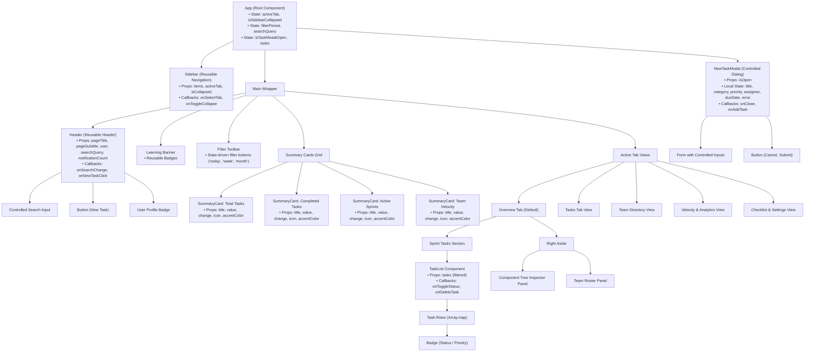

# Day 1 Submission: Component Tree Sketch & Architecture

**Project:** PugArch OpsHub — Intern Training Capstone  
**Day:** 1 (React Foundations & Component Thinking)  
**Track:** 20-Day Web Development Intern Training Plan  
**Submission Requirement:** Working UI and Component Tree Sketch

---

## 1. Visual Component Tree (Mermaid)



---

## 2. Textual Component Hierarchy & Data Flow

```text
App (Root Component)
 │
 ├── [State Managed Here]
 │    ├── activeTab: 'overview' | 'tasks' | 'team' | 'analytics' | 'settings'
 │    ├── isSidebarCollapsed: boolean
 │    ├── filterPeriod: 'today' | 'week' | 'month'
 │    ├── searchQuery: string
 │    ├── isTaskModalOpen: boolean
 │    └── tasks: Array<TaskObject>
 │
 ├── <Sidebar />
 │    ├── Props: items, activeTab, isCollapsed
 │    └── Events: onSelectTab(tabId), onToggleCollapse()
 │
 ├── <Header />
 │    ├── Props: pageTitle, pageSubtitle, user, searchQuery, notificationCount
 │    ├── Events: onSearchChange(query), onNewTaskClick()
 │    └── Composed Children: <Button />, <Badge />
 │
 ├── <LearningBanner />
 │    └── Composed Children: <Badge variant="..." />
 │
 ├── <FilterToolbar />
 │    └── Events: setFilterPeriod('today' | 'week' | 'month')
 │
 ├── <SummaryCard /> (Instance 1: Total Tasks)
 │    └── Props: title="Total Tasks", value, change, icon=CheckSquare, accentColor="#2563eb"
 ├── <SummaryCard /> (Instance 2: Completed Tasks)
 │    └── Props: title="Completed Tasks", value, change, icon=CheckCircle2, accentColor="#059669"
 ├── <SummaryCard /> (Instance 3: Active Sprints)
 │    └── Props: title="Active Sprints", value, change, icon=Layers, accentColor="#7c3aed"
 ├── <SummaryCard /> (Instance 4: Team Velocity)
 │    └── Props: title="Team Velocity", value, change, icon=Users, accentColor="#d97706"
 │
 ├── <TaskList />
 │    ├── Props: tasks={filteredTasks}
 │    ├── Events: onToggleStatus(taskId), onDeleteTask(taskId)
 │    └── Composed Children: <Badge /> (Status & Priority)
 │
 └── <NewTaskModal />
      ├── Props: isOpen={isTaskModalOpen}
      ├── Local Form State: title, category, assignee, priority, dueDate, error
      ├── Events: onClose(), onAddTask(newTask)
      └── Composed Children: <Button variant="secondary" />, <Button variant="primary" />
```

---

## 3. Data & Event Flow Breakdown (Unidirectional Data Flow)

| Component | Responsibility | Props Received | State Owned | Events Emitted / Handled |
| :--- | :--- | :--- | :--- | :--- |
| **`App.jsx`** | Single Source of Truth for global dashboard state | None (Root) | `activeTab`, `isSidebarCollapsed`, `filterPeriod`, `searchQuery`, `isTaskModalOpen`, `tasks` | Coordinates all state transitions via setter functions (`setTasks`, `setActiveTab`, etc.) |
| **`Sidebar.jsx`** | Main application navigation and collapse toggling | `items`, `activeTab`, `isCollapsed` | None (Stateless Presentational) | `onClick={() => onSelectTab(item.id)}`, `onClick={onToggleCollapse}` |
| **`Header.jsx`** | Top branding, live search bar, user profile, and primary call-to-action | `pageTitle`, `pageSubtitle`, `user`, `searchQuery`, `notificationCount` | None (Controlled by App) | `onChange={(e) => onSearchChange(e.target.value)}`, `onClick={onNewTaskClick}` |
| **`SummaryCard.jsx`** | Metric KPI display with trend indicators and colored icons | `title`, `value`, `change`, `changeType`, `icon`, `trendLabel`, `accentColor` | None (Pure Presentational) | Visual hover effects |
| **`TaskList.jsx`** | Renders sprint task table, handles item completion and deletion | `tasks` (array of objects) | None (Stateless) | `onClick={() => onToggleStatus(task.id)}`, `onClick={() => onDeleteTask(task.id)}` |
| **`NewTaskModal.jsx`** | Modal dialog for creating new tasks with validation | `isOpen` | `title`, `category`, `assignee`, `priority`, `dueDate`, `error` (Local UI State) | `onSubmit={(e) => handleSubmit(e)}`, `onClose()`, `onAddTask(newTask)` |
| **`Badge.jsx`** | Reusable pill badge for status and priorities | `children`, `variant`, `size` | None | None |
| **`Button.jsx`** | Reusable design-system button with variants and icons | `children`, `onClick`, `variant`, `size`, `icon`, `disabled`, `type` | None | `onClick={onClick}` |

---

## 4. Key Architectural Patterns Demonstrated

1. **Lifting State Up:**
   - Both the `<Header />` search bar and the `<TaskList />` need access to the search query. Rather than duplicating state, `searchQuery` is lifted to `App.jsx`, passed down to `<Header />` as a prop with an `onSearchChange` callback, and used in `App.jsx` to filter `tasks` passed down to `<TaskList />`.
   - The `<NewTaskModal />` collects user input locally, but when submitted, calls `onAddTask(newTask)` to lift the new task data up to `App.jsx`, immediately updating the task list and recalculating summary card numbers.

2. **Component Composition:**
   - `<Button />` and `<Badge />` are atomic primitive components used inside `<Header />`, `<TaskList />`, and `<NewTaskModal />`.
   - Components accept `children` props to allow flexible content injection without rigid prop schemas.

3. **Controlled Components:**
   - The search input in `<Header />` and form inputs in `<NewTaskModal />` are 100% controlled. Their displayed values match React state (`value={...}`), and changes are intercepted via `onChange`.
